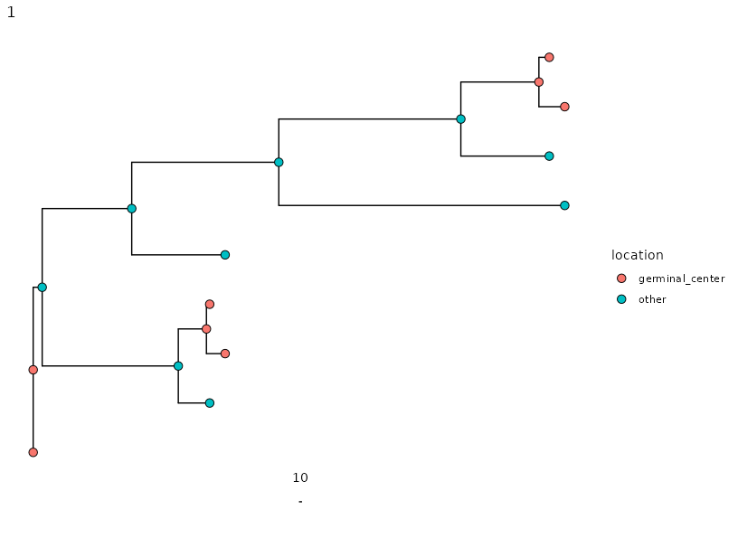
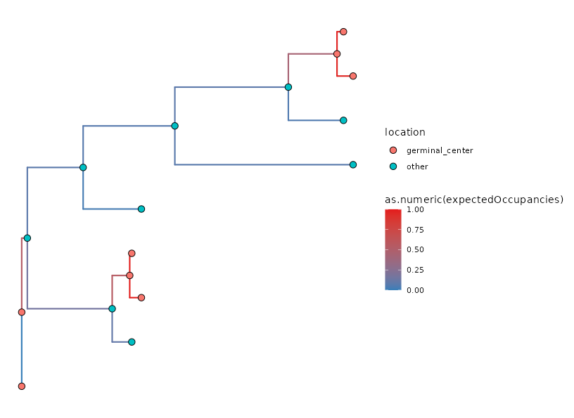

.. _reversible-vignette:

Build TyCHE Trees with Reversible Type-Switching using Dowser
=============================================================

This guide walks through using a ``TypeLinkedExpectedOccupancy``
model with reversible switching, which allows type switching in
both directions -- appropriate when your population can genuinely
re-enter a type it has already left, such as a memory B cell
founding a recall GC. When types can only switch in one direction,
such as a primary immune response, where memory B cells don't start
recall reactions, or certain hypermutator phenotypes that are irreversible,
:ref:`dowser-vignette` walks through using a ``TypeLinkedExpectedOccupancy``
model with irreversible switching.

For more help choosing between reversible and irreversible switching, see
:ref:`reversible-vs-irreversible`

Requirements
************

This tutorial requires Dowser 2.4.1.999 (dev) or 2.4.2 (release) or later.

You will also need to have BEAST2, TyCHE (v0.0.10 or later) and rootfreqs installed on your machine.

.. include:: installation_guide.rst

Download and set up XML templates
*********************************

BEAST models are specified and run through XML files. A template is required to run BEAST2 through Dowser.

We provide several BEAST XML templates in the
`xml-templates repository <https://github.com/hoehnlab/xml-templates/>`_. You can
download these and modify them as needed. Additionally, you can create your own
XML templates for custom analyses.

The template used in this tutorial is:

- ``TypeLinked/TypeLinkedExpectedOccupancy_EstTraitClockRates_EmpFreq.xml``: A type-linked clock model using an expected occupancy method for determining the proportion of each branch in each state, estimating separate clock rates for each state, and using empirical nucleotide frequencies.

You can specify the path to the
template in the ``template`` argument of ``getTimeTreesIterate``, or you can pass a
connection object to the ``template`` argument, e.g.
``getTimeTreesIterate(..., template = url(<url-to-github-file-raw>), ...)``. In this
tutorial, we assume you have downloaded the above templates to your working directory.

Setting Up Data
*******************

This step proceeds as in tree building, but it is important to specify the column
of the trait you want to analyze in the ``formatClones`` step. In this example we are
using simulated data from germinal center and "other" tissue. However, this could
be any discrete trait value such as cell types.

This data can be found in the TyCHE package's ``examples/airr`` folder.

.. code-block:: r

    library(dowser)
    library(dplyr)
    library(ggtree)

    # load example AIRR tsv data
    ExampleRecallData <- read.csv(
        "example_airr_tyche_recall.tsv",
        sep = "\t", stringsAsFactors = FALSE
    )

    # set up time/date trait
    ExampleRecallData$sample_time <- as.numeric(ExampleRecallData$sample_time)

    # trait value of interest
    trait="location"

    clones <- formatClones(
    ExampleRecallData,
    traits = c(trait, "sample_time"),
    germ   = "germline_alignment"
    )

    # use only the first two clones for time
    clones <- clones[1:2, ]

Estimating Type-Specific Clock Rates When Switching Is Reversible
**********************************************************************

The :ref:`irreversible vignette <dowser-vignette>` estimates the GC clock rate by filtering to
``location=="germinal_center"`` and fitting a strict clock model to that
subset alone. That works because irreversibility guarantees the
subset is a *pure* population: if a cell is currently labeled GC, and GC
cells never re-enter from elsewhere, then it was GC for its entire
observed history.

Reversibility breaks that guarantee. If a cell can re-enter GC from
"other," then a cell currently labeled GC might only have arrived
recently -- so a subset filtered by current label is more likely a
mixture of both underlying rates, not a clean sample of one. Fitting a
strict clock to that subset can give you a rate that's some blend of the
GC and non-GC rates, rather than a trustworthy estimate of either.

If part of your data comes from a segment
you have independent reason to believe was effectively irreversible over
the sampled window -- for example, a primary reaction sampled before any
recall event could plausibly have occurred -- you can still get a clean
rate estimate from that segment, even though the overall system allows
switching in both directions.

Absent that kind of segment, we recommend using an
external clock rate estimate. For this vignette, we
reuse the :ref:`irreversible vignette's <dowser-vignette>` GC rate estimate as a stand-in, but
give it a wider prior than the irreversible tutorial does, to reflect
that added uncertainty:

.. code-block:: r

    gcrate <- 0.000363 # from the getting started vignette's strict clock fit

Setting RATE_INDICATORS for a Reversible Model
***********************************************

Allowing switching in both directions means both slots of
``RATE_INDICATORS`` are set to ``1``:

.. code-block:: r

    RATE_INDICATORS = "1 1"

Fixing the Root Type
************************

Reversibility on its own makes an analysis harder to fit reliably. TyCHE
and Dowser provide two additional constraints to help; the first is
fixing the type at the root.

In Dowser, this is set with the ``root_trait`` argument, given as the
literal trait value you want to fix the root to:

.. code-block:: r

    root_trait = "germinal_center"

Dowser matches this string exactly against the values observed in your
trait column and ensures TyCHE runs with the root type constrained
to ``root_trait``, in this case the root will always have type "germinal_center".

Capping the Maximum Root Height
*******************************

The second constraint bounds how far back in time the root is allowed to
be. In Dowser, this is the ``max_start_date`` argument, given in the same
units as your ``time`` column. It sets the *earliest*
calendar day (or week, or whatever your time unit is) the
root is allowed to take -- equivalently, a cap on the maximum age of the
root.

Set this using independent information whenever you have it -- a
known infection date, a first-vaccination date, a diagnosis date --
rather than an arbitrary number.

Because this vignette's example
data is a simulation, we know the true root date is ``0``, but we can
choose an illustrative value that is 1000 days earlier than that.

.. code-block:: r

    max_start_date = -1000

Build TyCHE trees
*****************

We can now run a type-linked TyCHE model. Here, we use the
*TypeLinkedExpectedOccupancy* model, which uses an expected
occupancy method to determine the proportion of each branch
in each state.

Features of this template:

-   Allows estimation of clock rates:
    -   we provide values of the mean (``TRAIT_RATE_MEAN_1``, ``TRAIT_RATE_MEAN_2``) and standard deviation (``TRAIT_RATE_SIGMA_1``, ``TRAIT_RATE_SIGMA_2``) for the prior normal distributions of each clock rate.
-   Uses empirical nucleotide frequencies as the equilibrium frequencies.
    -   Dowser will automatically calculate these frequencies from the input sequences.
    -   Recommended for most data, especially BCRs.

.. include:: getTimeTreesIterate_and_ess.rst

The next step takes about 10 minutes to run, depending on your machine, as a quick demonstration. Expect results to be unconverged. To get more reliable results, set larger ``mcmc_length`` or ``iterations``.

.. code-block:: r

    # edit to your BEAST installation path
    beast <- "/Applications/BEAST 2.7.7/bin/"

    reversible_trees <- getTimeTreesIterate(
        clones,
        beast    = beast,
        template = "TypeLinkedExpectedOccupancy_EstTraitClockRates_EmpFreq.xml",
        trait    = trait,
        time     = "sample_time",
        dir      = "temp",
        id       = "tyche_eo_reversible",
        log_every = "auto",
        nproc     = 2,
        KAPPA_PRIOR_M = 0.67,
        KAPPA_PRIOR_S = 0.2,
        TRAIT_RATE_MEAN_1 = gcrate,
        TRAIT_RATE_MEAN_2 = 0.000001,
        TRAIT_RATE_SIGMA_1 = gcrate * 0.1,
        TRAIT_RATE_SIGMA_2 = 0.001,
        RATE_INDICATORS = "1 1",
        root_trait = "germinal_center",
        max_start_date = -1000,
        TYPE_SWITCH_INIT = 0.005,
        TYPE_SWITCH_ALPHA = 0.001,
        TYPE_SWITCH_BETA = 5.0,
        TRANSITION_RATE_1_INIT = 1.0,
        TRANSITION_RATE_2_INIT = 1.0,
        TRANSITION_RATE_ALPHA_1 = 0.1,
        TRANSITION_RATE_BETA_1  = 1.0,
        TRANSITION_RATE_ALPHA_2 = 0.1,
        TRANSITION_RATE_BETA_2  = 1.0,
        log_target   = 2000,
        mcmc_length  = 1e6,
        ignore       = c("freqParameter"),
        iterations   = 20
    )

``getTimeTreesIterate`` will run BEAST2 on each clone in parallel (here, ``nproc=2``, so 2 at a time).

To capture sufficient information about the posterior distribution while keeping log files from becoming overly large or unwieldy, we provide the option to set ``log_every="auto"``. This will automatically set the logging frequency based on the ``mcmc_length`` and ``log_target`` (here, ``2000``, so we aim to have around 2000 samples in the log file). You can also set a fixed logging frequency by providing an integer value.

You can also specify alpha (shape) and beta (rate) values for the prior gamma distributions of the transition rates between traits. We recommend setting the same prior for each transition rate except in rare cases.

The prior distribution on kappa is used by the nucleotide substitution model, and we recommend these values for BCR analyses.

Visualize the results and use BEAST2 parameter outputs
******************************************************

After the analyses have converged, you can visualize the time trees.

Note: plotTrees sets a default value for the scale bar of 0.01, which is appropriate
for trees with genetic distance branch lengths (mutations per site), but time trees typically
require a larger scale bar. In this case, we know the data spans 200 time units,
so we set ``scale=10`` to make the scale bar more visually interpretable.

.. code-block:: r

    plotTrees(reversible_trees, scale=10)[[1]] + geom_point(aes(fill=location), pch=21, size=3)

If we want to visualize how much of each branch is estimated in
each state, we can plot the "expected occupancy" of each branch.
This shows how much time TyCHE estimates each branch spends in
the GC. The expected occupancy is a value between 0 and 1, so
we can use a gradient color scale to visualize it.

.. code-block:: r

    colors = RColorBrewer::brewer.pal(3,"Set1")
    names(colors) = c("germinal_center", "other", "Ambig.")
    eo_line_color_scale <- scale_color_gradient(
        low = colors["other"],
        high = colors["germinal_center"],
        breaks = c(0, 0.25, 0.5, 0.75, 1),
        limits = c(0, 1)
    )

    ggtree(reversible_trees$trees[[1]], aes(color = as.numeric(expectedOccupancies)),linewidth = 0.75) +
      geom_point(aes(fill = location), pch = 21, size = 3, color = "black") +
      eo_line_color_scale

The ``parameters`` column of ``mixed_trees`` contains a table that collates the output from the BEAST2 analysis. Columns include the parameter (item), the posterior mean, standard error, standard deviation, median, 95% highest posterior density interval, autocorrelation time (ACT), effective sample size, and geometric mean.

The effective sample size (ESS) of a parameter is a measure of how much independent information your MCMC sample contains. Even though MCMC generates many samples, they are typically autocorrelated—each sample depends on the previous one. ESS is the number of independent draws from the target distribution with the same estimation power and can be thought of as the sample size for that parameter.

A higher ESS means your sample more reliably represents the posterior distribution. Low ESS indicates that you need more information, which can indicate the need for longer MCMC runs. We typically recommend an ESS of at least 200 for each estimated parameter.

The autocorrelation time (ACT) of a parameter measures how strongly each sample in the MCMC chain depends on previous samples. The ACT tells you how long the MCMC chain takes to produce a roughly independent sample. ACT is inversely related to ESS.

If we're interested in the estimated tree height, we can filter the parameters table for ``TreeHeight``:

.. code-block:: r

    print(reversible_trees$parameters[[2]] %>% filter(item=="TreeHeight"))

.. code-block:: r

                item     mean   stderr   stddev   median X95.HPDlo X95.HPDup      ACT        ESS geometric.mean
        1 TreeHeight 1749.689 6.354525 234.3267 1759.836  1264.156  2142.116 13237.52   1359.808       1733.329

Our model likely hasn't converged, with multiple parameters having ESS values below 200, particularly the posterior which describes how well the model has converged as a whole. The mean tree height is around 1750 days, with a 95% highest posterior density interval from about 1260 to 2140 days. Since we know the data spans 1200 days, this is a high estimate, but this is unsurprising given that the ESS is below 200 and the analysis has likely not converged.

The parameters available will depend on the model you used and what is specified for
logging in the XML template. In this case, we can see all the items that were logged:

.. code-block:: r

    print(reversible_trees$parameters[[2]]$item)

.. code-block:: r

     [1] "posterior"                            "likelihood"
     [3] "prior"                                "treeLikelihood.tyche_eo_reversible_2"
     [5] "typedTreeLikelihood.type"             "TreeHeight"
     [7] "rateIndicator.pe.1"                   "rateIndicator.pe.2"
     [9] "relativeGeoRates.pe.1"                "relativeGeoRates.pe.2"
    [11] "typeSwitchClockRate"                  "kappa.che_eo_reversible_2"
    [13] "BayesianSkyline"                      "bPopSizes.1"
    [15] "bPopSizes.2"                          "bPopSizes.3"
    [17] "bPopSizes.4"                          "bPopSizes.5"
    [19] "bGroupSizes.1"                        "bGroupSizes.2"
    [21] "bGroupSizes.3"                        "bGroupSizes.4"
    [23] "bGroupSizes.5"                        "freqParameter.che_eo_reversible_2.1"
    [25] "freqParameter.che_eo_reversible_2.2"  "freqParameter.che_eo_reversible_2.3"
    [27] "freqParameter.che_eo_reversible_2.4"  "traitfrequencies.pe.1"
    [29] "traitfrequencies.pe.2"                "typeLinkedRates.1"
    [31] "typeLinkedRates.2"

These include the posterior, likelihood, and prior probabilities of the full model; the tree likelihood; estimated values of the tree height, the clock rates for each type (``typeLinkedRates``), the relative transition rates between types (``relativeGeoRates``), the rate of switching types (``typeSwitchClockRate``); parameters relating to BayesianSkyline (``BayesianSkyline``, ``bPopSizes``, ``bGroupSizes``); the transition/transversion rate ratio kappa for the HKY substitution model; and some fixed parameters that are included in logging for record-keeping convenience (i.e., the empirical frequencies of the nucleotides and the frequencies of the types).

If you want to revisit an analysis and no longer have the ``reversible_trees`` object
in your R environment, you can use ``readBEAST`` to read in the BEAST log and tree
files from the directory (``dir``) you specified in ``getTimeTreesIterate``. Because of this,
it is important to always specify a unique combination of ``dir`` and ``id`` for each analysis.

.. code-block:: r

    reversible_trees <- readBEAST(clones, dir="temp", id="tyche_eo_reversible", beast=beast, trait=trait)

See ``?readBEAST`` for more details.

.. raw:: html

    

    
Tip

    You can find all of BEAST's output files, including the trees, logs, console logs, and TreeAnnotator outputs, in the `dir` you specified (here, "temp"). You can view these files using BEAST tools such as Tracer.
          
    
