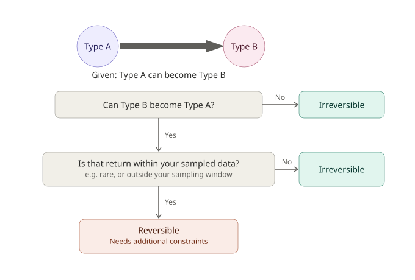

.. _reversible-vs-irreversible:

Reversible vs. irreversible type switching
============================================

TyCHE lets you decide whether switching between types is **reversible** or
**irreversible**. This guide helps you figure out which one matches your
data and how to use TyCHE in each case. In our paper, many of the biological analyses used an irreversible model, simply
because in those systems the underlying biology only runs one way, such as primary germinal center reactions or glioma gaining hypermutator mutations.

In short, once your cell (or organism) switches from one type to another, can it switch back? If the
answer is no, you want an irreversible model. If it can genuinely go back
and forth, you want a reversible model -- but reversible models need some
extra help to stay identifiable, which is what most of this guide covers.

How this choice is expressed in TyCHE
---------------------------------------

In Dowser, this is controlled by the ``RATE_INDICATORS`` argument, a
string with two slots, one per direction of switching. Each slot is either
``1`` (that direction is allowed) or ``0`` (that direction is disallowed).
Setting both slots to ``1`` gives you a reversible model; setting one slot
to ``0`` gives you an irreversible model in the remaining direction.

The slot order is based on the order of your two state labels, which is by default alphabetical. Specifically, if your types are "A" and "B":

.. code-block:: text

   RATE_INDICATORS = "<whether A to B is allowed> <whether B to A is allowed>"

This matters because the same biological direction can produce different
``RATE_INDICATORS`` strings depending on what you happen to name your
states. If you renamed state A to state Z, the order of the rate indicators would need to flip to describe the same direction of switching.

Irreversible processes
----------------------

One of your cell types can become the other, but not vice versa. Organisms or cells in one trait state can become the other, but cannot switch back.

This includes cases where it's biologically possible to switch back,
but incredibly unlikely to happen under the conditions present during your sample
window -- such as during primary germinal center reactions.

Some examples of real-data analyses that would use irreversible models:

- **HIV chronic germinal centers** These are primary germinal center reactions,
  so we do not expect to see any memory B cell "recall" behavior, where memory B
  cells start or join recall germinal centers in secondary infections/stimuli.
- **Hypermutating glioma** Once a tumor lineage acquires the
  hypermutator phenotype, it doesn't revert to non-hypermutator.

The payoff for choosing an irreversible model
is that you don't need many additional constraints. Irreversibility helps convergence and identifiability whenever it's biologically justified.

Set ``RATE_INDICATORS`` so the disallowed direction's slot is
``0`` (i.e. ``"1 0"`` or ``"0 1"``, according to the alphabetical order). See
the building time trees with dowser and tyche guide for an example of this.

Reversible processes
--------------------

Your cell (or organism) can switch from
type A to type B, and it is biologically plausible for it to switch back.

A clear example of this is B cell recall responses, such as following repeated
vaccinations, where a memory B cell formed after a primary exposure can go on to found a new GC reaction after a later
vaccination.

Reversibility on its own makes these analyses harder to fit reliably so two additional
constraints are recommended to keep the reversible model identifiable:

1. **Fix the root type.** Rather than letting the model freely infer what
   type the root started as, fix it to a known value. TyCHE implements
   this with ``RootTypePrior``, which takes prior information about the root. In Dowser, this is set as a hard constraint for you when you use the ``root_trait`` argument.
2. **Cap the maximum tree height.** Bound how far back in time the root
   is allowed to be. Without this, a reversible model with otherwise weak
   evidence can wander to implausible root dates. This is especially helpful if you
   have known dates that the lineage started after, such
   as primary infection dates for B cell lineages, but is also useful when you have estimates or other reasonable ways to infer maxima. This is set in Dowser
   via the ``max_start_date`` argument.

.. raw:: html

    

    
Tip

        Both of these are worth setting even if you think your data alone
        would pin down the root reasonably well -- our benchmarking found that
        reversibility plus weak or absent constraints could produce
        biologically implausible root dates, not just wide uncertainty
        intervals.
          
    

Reversible doesn't mean symmetric
-------------------------------------------

Turning both directions on with ``RATE_INDICATORS`` only says that both
directions are *possible*. It says nothing about how *fast* each one
happens. TyCHE still estimates (or fixes, if you provide values) a
separate relative rate for each direction -- these are the
``relativeGeoRates`` parameters, one per direction, matching the same
alphabetical ordering as ``RATE_INDICATORS``.

In practice, this means a reversible model can still be highly asymmetric.
A memory B cell re-entering a GC during a recall response, for example,
may happen far less often than the original GC-to-memory differentiation
-- both directions are switched on, but nothing forces them to occur at
similar rates.

If you do have evidence that one direction is much rarer than the
other, you can reflect that in your priors for the relevant
transition rate rather than leaving both at the same default. Conversely, if you
have strong data and the model is identifiable, you can leave both rates to be estimated and use the resulting posterior to see if the data support a strong asymmetry.

Relevant vignettes
------------------

For the irreversible case, :ref:`dowser-vignette` walks through a
full example end to end -- estimating a GC clock rate, then running a
``TypeLinkedExpectedOccupancy`` model with ``RATE_INDICATORS="1 0"`` on
GC/other B cell data. Start there if you haven't set up a TyCHE analysis
before.

For the reversible case, :ref:`reversible-vignette` walks through how to set up a reversible model with the recommended constraints, using a recall-GC-style analysis as an example.
