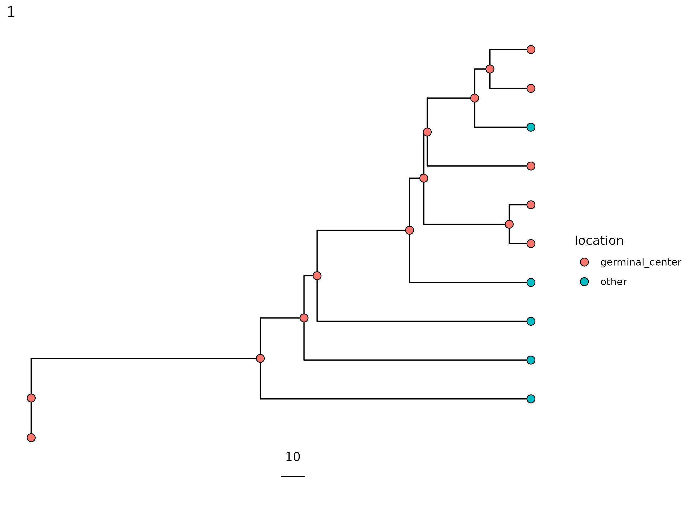
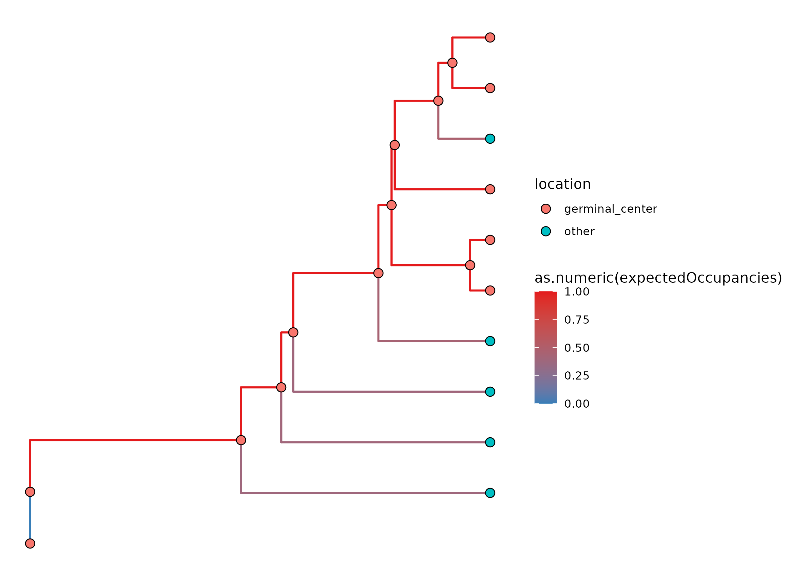

.. _single-timepoint-vignette:

Build TyCHE Trees from a Single Timepoint with Dowser
========================================================

This guide walks through fitting a ``TypeLinkedExpectedOccupancy`` model
when your data comes from a single sample rather than
serial timepoints -- for example, a single lymph node biopsy.

With only one sampled
timepoint, there's no within-dataset signal to estimate a clock rate from,
so this guide covers: sourcing a clock
rate externally, thinking about how sensitive your results are to that
choice, and the model constraints recommended for a single-timepoint analysis.

Requirements
************

This tutorial requires Dowser 2.4.1.999 (dev) or 2.4.2 (release) or later.

You will also need to have BEAST2, TyCHE (v0.0.10 or later) and rootfreqs installed on your machine.

.. include:: installation_guide.rst

Download and set up XML templates
*********************************

BEAST models are specified and run through XML files. A template is required to run BEAST2 through Dowser.

We provide several BEAST XML templates in the
`xml-templates repository <https://github.com/hoehnlab/xml-templates/>`_. You can
download these and modify them as needed. Additionally, you can create your own
XML templates for custom analyses.

The template used in this tutorial is:

- ``TypeLinked/TypeLinkedExpectedOccupancy_EstTraitClockRates_EmpFreq.xml``: A type-linked clock model using an expected occupancy method for determining the proportion of each branch in each state, estimating separate clock rates for each state, and using empirical nucleotide frequencies.

You can specify the path to the
template in the ``template`` argument of ``getTimeTreesIterate``, or you can pass a
connection object to the ``template`` argument, e.g.
``getTimeTreesIterate(..., template = url(<url-to-github-file-raw>), ...)``. In this
tutorial, we assume you have downloaded the above templates to your working directory.

Setting Up Data
****************

This step proceeds as in tree building, but it is important to specify the column
of the trait you want to analyze in the ``formatClones`` step. In this example we are
using simulated data from germinal center and "other" tissue. However, this could
be any discrete trait value such as cell types.

Because we are re-using a simulated dataset that has multiple timepoints, we also
filter out all but one timepoint from this data to create a single timepoint dataset.

.. code-block:: r

    library(dowser)
    library(dplyr)
    library(ggtree)

    # load example AIRR tsv data
    data(ExampleAirrTyCHE)

    # set up time/date trait
    ExampleAirrTyCHE$sample_time <- as.numeric(ExampleAirrTyCHE$sample_time)

    # keep only one timepoint -- simulating a single sample
    ExampleAirrTyCHE <- filter(ExampleAirrTyCHE, sample_time == 100)

    # trait value of interest
    trait <- "location"

    clones <- formatClones(
        ExampleAirrTyCHE,
        traits = c(trait, "sample_time"),
        germ   = "germline_alignment"
    )

Every tip in every clone now shares the same ``sample_time``.

In your data, you can set the time column to have any value -- e.g. 0 or days
post-infection/post-stimulus. Downstream functions rely on this column's
existence and TyCHE will infer dates relative to this value. However,
you can later add or subtract a fixed delta to the dates in the results to get
the dates relative to another fixed timepoint.

Estimating Clock Rates from an Outside Source
**********************************************

With a single timepoint, there's no meaningful way to estimate a clock
rate from this dataset: a root-to-tip regression needs variation in
sample time to fit a slope against, and a strict clock model is in the
same position. Any rate you tried to fit here would be an artifact of the
model, not a real estimate.

We recommend sourcing the clock rate externally: you can use a root-to-tip
regression on a *separate* or previously-published longitudinal
dataset, and use the mean rate across those lineages as the mean of a
tight ("strong") prior for GC B cells.

For our simulated data, we don't have a second, genuinely independent
dataset that represents the same system on hand.
For continuity, we'll reuse the strict-clock estimate (fit on the
multi-timepoint data) from :ref:`dowser-vignette` as a stand-in.
For your own analysis, you can estimate a rate from another dataset
(see :ref:`dowser-vignette` for suggested ways to estimate the rate from
that data).

.. code-block:: r

    gc_rate_external <- 0.000363 # stand-in for an external estimate

We want to use a tight ("strong") prior around this value, because we
have no within-dataset information at all to update the rate with, so
trying to estimate it would be meaningless. Instead, we
deliberately keep it close to fixed. We do this by setting a prior
with a sigma of 1% of the mean.

Non-GC cells
were fixed similarly, at an arbitrarily low rate reflecting the
assumption that they don't accumulate somatic mutations.

.. code-block:: r

    TRAIT_RATE_MEAN_1  <- gc_rate_external
    TRAIT_RATE_SIGMA_1 <- gc_rate_external * 0.01   # ~fixed, matching the paper's approach

    TRAIT_RATE_MEAN_2  <- 0.000001   # arbitrarily low, non-GC cells assumed not to mutate
    TRAIT_RATE_SIGMA_2 <- 0.000001 * 0.01

A Note on Sensitivity
**********************

Because the rate is essentially fixed by your prior rather than informed
by the data, every date your analysis produces -- root date, node dates,
differentiation times -- is conditional on that rate being right. Results
from this approach should be read as conditioned on the provided clock
rate.

For more discussion on the sensitivity of TyCHE to the GC rate prior,
see `our paper <https://www.biorxiv.org/content/10.1101/2025.10.21.683591v2.full>`_

Irreversibility
***************

In addition to the rate discussed above, we still need to decide whether
type switching is reversible or irreversible -- see
:ref:`reversible-vs-irreversible` if you haven't worked through that
question yet. This simulated data represents a primary GC reaction,
so switches from non-GC back into GC are disallowed:

.. code-block:: r

    RATE_INDICATORS <- "1 0"

Fitting a single-timepoint reversible model would require careful
attention to other parameters that may be non-identifiable or
unable to be informed by the data -- such as the overall rate at
which type switches occur as well as relative rates of switching
from each type to the other.

Build TyCHE Trees
*****************

We can now run a type-linked TyCHE model, combining the external rate
priors and the irreversible rate indicator above.

.. raw:: html

    

    
Tip

        This step takes about 30 minutes to run, depending on your machine.
        For a quick demonstration set smaller `mcmc_length` or `iterations`,
        but expect results to be unconverged.
          
    

.. code-block:: r

    # edit to your BEAST installation path
    beast <- "/Applications/BEAST 2.7.7/bin/"

    single_tp_trees <- getTimeTreesIterate(
        clones,
        beast     = beast,
        template  = "TypeLinkedExpectedOccupancy_EstTraitClockRates_EmpFreq.xml",
        trait     = trait,
        time      = "sample_time",
        dir       = "temp",
        id        = "tyche_eo_single_tp",
        log_every = "auto",
        nproc     = 2,
        KAPPA_PRIOR_M = 0.67,
        KAPPA_PRIOR_S = 0.2,
        TRAIT_RATE_MEAN_1  = TRAIT_RATE_MEAN_1,
        TRAIT_RATE_MEAN_2  = TRAIT_RATE_MEAN_2,
        TRAIT_RATE_SIGMA_1 = TRAIT_RATE_SIGMA_1,
        TRAIT_RATE_SIGMA_2 = TRAIT_RATE_SIGMA_2,
        RATE_INDICATORS = RATE_INDICATORS,
        TYPE_SWITCH_INIT  = 0.005,
        TYPE_SWITCH_ALPHA = 0.001,
        TYPE_SWITCH_BETA  = 5.0,
        TRANSITION_RATE_1_INIT = 1.0,
        TRANSITION_RATE_2_INIT = 1.0,
        TRANSITION_RATE_ALPHA_1 = 0.1,
        TRANSITION_RATE_BETA_1  = 1.0,
        TRANSITION_RATE_ALPHA_2 = 0.1,
        TRANSITION_RATE_BETA_2  = 1.0,
        log_target   = 2000,
        mcmc_length  = 1e6,
        ignore       = c("freqParameter"),
        iterations   = 20
    )

We still pass ``time = "sample_time"`` even though every tip shares the
same value -- BEAST2 handles equal tip dates without issue, and this ensures
that tip dates are fixed and will not be estimated relative to each other.

For more detailed discussion of ``getTimeTreesIterate``, see :ref:`dowser-vignette`.

Visualize the Results
**********************

.. code-block:: r

    plotTrees(single_tp_trees, scale = 10)[[1]] + geom_point(aes(fill = location), pch = 21, size = 3)

Because every tip shares one sample date, all tips line up at the same
point on the time axis. The internal node heights (e.g. the estimated
root date and any differentiation dates) are shown relative to the tips.

As before, we can plot the expected occupancy of each branch to see how
much of it TyCHE estimates was spent in the GC:

.. code-block:: r

    colors <- RColorBrewer::brewer.pal(3, "Set1")
    names(colors) <- c("GC", "Other", "Ambig.")
    eo_line_color_scale <- scale_color_gradient(
        low    = colors["Other"],
        high   = colors["GC"],
        breaks = c(0, 0.25, 0.5, 0.75, 1),
        limits = c(0, 1)
    )

    ggtree(single_tp_trees$trees[[1]], aes(color = as.numeric(expectedOccupancies)), linewidth = 0.75) +
      geom_point(aes(fill = location), pch = 21, size = 3, color = "black") +
      eo_line_color_scale

For more help on the output of ``getTimeTreesIterate`` and visualizing your results, see :ref:`dowser-vignette`.

